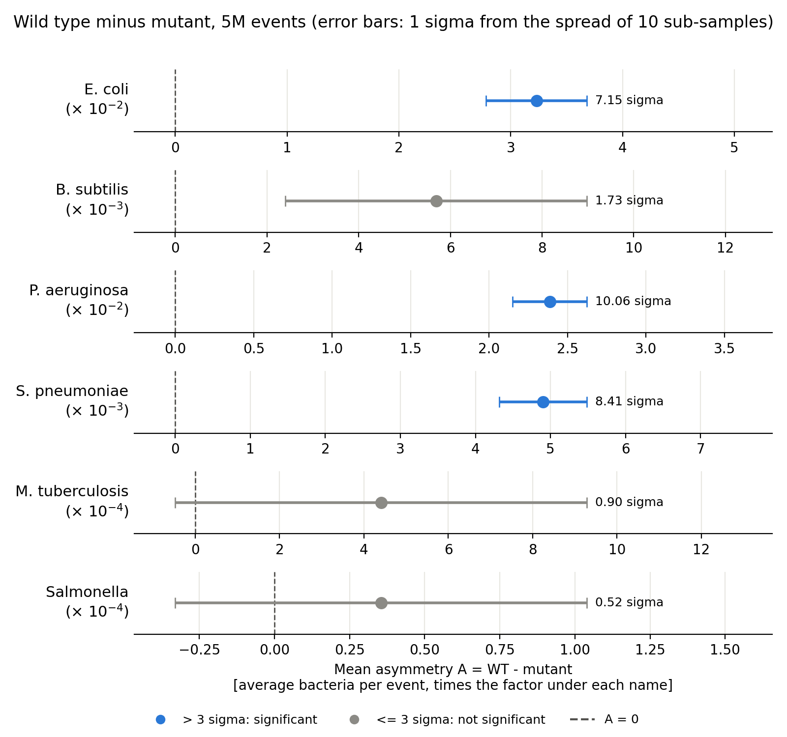
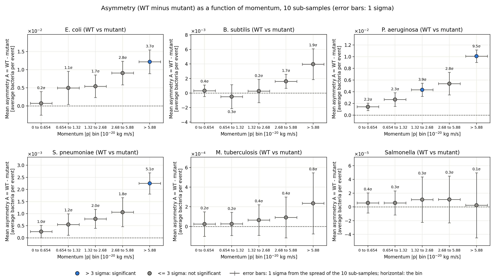
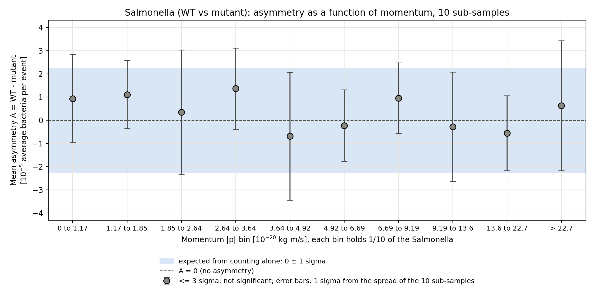
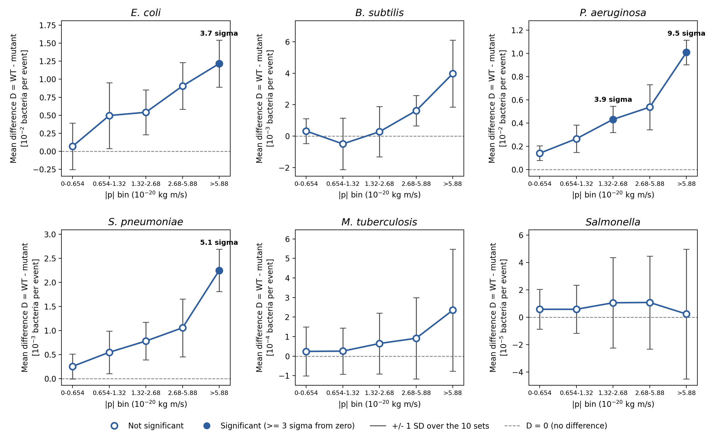
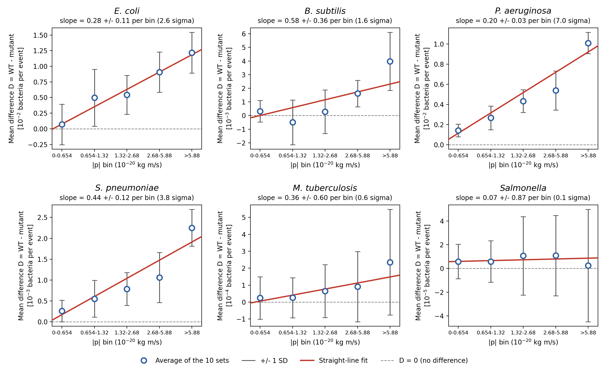

# Final README: Wild-type vs Mutant Bacteria in 5 Million Events

**PRA2003, biology track · final version (week 7 deliverable)** ·
Frederique Mol · group R2 · 13 October 2026

## At a glance

**Do we see a bacteria asymmetry? Yes.** In 3 of the 6 strains the wild
type is significantly more common than its mutant (more than 3σ from 0):

| Strain | Mean asymmetry A = WT − mutant [bacteria per event] | Statistical uncertainty | n σ | Asymmetry? |
|---|---:|---:|---:|:---:|
| *E. coli* | 0.0323 | ± 0.0045 | 7.15 | **yes** |
| *B. subtilis* | 0.00569 | ± 0.00329 | 1.73 | no |
| *P. aeruginosa* | 0.02387 | ± 0.00237 | 10.06 | **yes** |
| *S. pneumoniae* | 0.00490 | ± 0.00058 | 8.41 | **yes** |
| *M. tuberculosis* | 0.00044 | ± 0.00049 | 0.90 | no |
| *Salmonella* | 0.000036 | ± 0.000069 | 0.52 | no |

- **The wild type is the more common form in all 6 strains**, but only for
  *E. coli*, *P. aeruginosa* and *S. pneumoniae* is the difference large
  enough compared with its uncertainty to be called an asymmetry.
- **The other 3 strains are consistent with no asymmetry.** They are not
  proven symmetric: their uncertainty is too large to see a small
  difference ([section 5](#5-is-there-an-asymmetry-between-wild-type-and-mutant)
  gives the upper limits).
- **As a function of momentum** the asymmetry of these 3 strains is positive
  in all 5 momentum bins, and no strain shows a significant momentum
  dependence ([section 7](#7-asymmetry-as-a-function-of-momentum), Figure 2).
- **How the uncertainty is calculated** is shown step by step, with the
  numbers of *E. coli*, in [section 3](#3-method).

| Asked for | Where |
|---|---|
| Mean asymmetry and its statistical uncertainty | Table above; details in [Section 5](#5-is-there-an-asymmetry-between-wild-type-and-mutant), Figure 1 |
| Plot of the asymmetry as a function of momentum, with the statistical uncertainty of every bin, made with Python | [Section 7](#7-asymmetry-as-a-function-of-momentum), Figure 2 (`asymmetry_momentum_all_FM.png`) |
| Numbers behind the plot (asymmetry, uncertainty and n σ per bin) | Table in section 7, `asymmetry_vs_momentum_FM.csv` |
| Code that makes it | `Week5_momentum_counting_FM.py` (counting, needs the raw data) and `Week5_asymmetry_vs_momentum_FM.py` (calculation and plots) |
| Line plot and straight-line fit of the mean difference per event | End of [Section 7](#7-asymmetry-as-a-function-of-momentum), Figures 3 and 4 (`momentum_lineplot_FM.png`, `momentum_fit_FM.png`), made by `Week5_group_figures_FM.py` |
| Salmonella in 10 momentum bins with equal numbers of bacteria (flat line at 0) | [Section 7](#7-asymmetry-as-a-function-of-momentum), Figure 5 (`salmonella_momentum_FM.png`), made by `Week7_salmonella_momentum_FM.py` |
| How to run everything | [Section 9](#9-how-to-install-and-reproduce) |
| Every file in this folder | [Section 10](#10-files-in-this-submission) |

## Contents

1. [Overview](#1-overview)
2. [Data](#2-data)
3. [Method](#3-method)
4. [Main result](#4-main-result)
5. [Is there an asymmetry between wild type and mutant?](#5-is-there-an-asymmetry-between-wild-type-and-mutant)
6. [Consistency check: Poisson vs sub-sampling](#6-consistency-check-poisson-vs-sub-sampling)
7. [Asymmetry as a function of momentum](#7-asymmetry-as-a-function-of-momentum)
8. [Discussion and limitations](#8-discussion-and-limitations)
9. [How to install and reproduce](#9-how-to-install-and-reproduce)
10. [Files in this submission](#10-files-in-this-submission)

---

## 1. Overview

Each bacterial strain in the data has a **wild-type** form (positive ID) and
a **mutant** form (the same ID with a minus sign), for example an
antibiotic-resistant strain. If a mutation changes how common a strain is,
the wild type and its mutant will occur with different frequencies.

**Why this matters:** mutations such as antibiotic resistance often carry a
*fitness cost*, which makes the mutant slightly less successful. Measuring
whether mutants are less common than their wild type is a direct way to
look for such a cost. Because the expected effect is small, a large sample
and a careful uncertainty estimate are needed.

**Questions** (the project goals set in week 1):

| Question | Where it is answered |
|---|---|
| 1. What is the **average number of each strain per event**, and its statistical uncertainty? | [Section 4](#4-main-result) |
| 2. Is there an **asymmetry between each wild type and its mutant**? | [Section 5](#5-is-there-an-asymmetry-between-wild-type-and-mutant) |
| 3. Does the asymmetry depend on **momentum**? | [Section 7](#7-asymmetry-as-a-function-of-momentum) (all 10 files) |

**Hypothesis:** if a mutation has no effect, the wild type and mutant have
the same average number per event, so the asymmetry
A = avg(WT) − avg(mutant) is 0 bacteria per event. An asymmetry is only claimed above
**3σ**.

---

## 2. Data

| Property | Value |
|---|---|
| Files used | `output-Set1.txt` … `output-Set10.txt`, from the course SURFdrive (not included: ~800 MB each) |
| Not used | `output-Set0.txt`, a test file with 1 event |
| Events | 500,000 per file, **5,000,000** in total |
| Non-empty events (used) | **4,617,993** in total, 461,650 – 462,025 per file |
| Different IDs found | 38: the 12 strains below + 26 other IDs |

Each file is plain text, made of repeating blocks:

```
<eventNumber> <nParticles>          ← header line
<px> <py> <pz> <ID>                  ← one line per bacterium (momentum + ID)
...
```

Events with 0 bacteria (e.g. a header `19 0`) contain no measurement, so
they are **not counted** in the number of events.

### Bacterial ID → strain

| ID | Strain | ID | Strain |
|---:|---|---:|---|
| 211 | *E. coli* WT | -211 | *E. coli* mutant |
| 321 | *Bacillus subtilis* WT | -321 | *B. subtilis* mutant |
| 2212 | *Pseudomonas aeruginosa* WT | -2212 | *P. aeruginosa* antibiotic-resistant |
| 3122 | *Streptococcus pneumoniae* | -3122 | Capsule-deficient *S. pneumoniae* |
| 3312 | *Mycobacterium tuberculosis* | -3312 | Drug-resistant *M. tuberculosis* |
| 3334 | *Salmonella enterica* | -3334 | *Salmonella* mutant |

---

## 3. Method

**Step 1: counting per file** (`Week4_part1_counting_FM.r`). Each of the 10 files is read
in chunks of 1,000,000 lines, so a file is never loaded into memory at
once. The IDs in each chunk are tallied with `table()`. For each ID and
file the script saves the count, the number of non-empty events, the
average per event and the Poisson uncertainty `sqrt(count) / events`.

**Step 2: combining the 10 sub-samples** (`Week4_part2_subsampling_FM.r`), with the
**sub-sampling method** from the lecture:

| Quantity | How it is calculated |
|---|---|
| **Central value** | total count ÷ total events over all 10 files (the per-file averages, weighted by their number of events) |
| **Statistical uncertainty** | standard deviation of the 10 per-file averages, used directly (no division by √10), as in the lecture |

**Step 3: asymmetry test** (`Week4_part3_asymmetry_FM.r`; Figure 1 is drawn in
Python by `Week4_part3_plot_FM.py`) for every pair X vs -X. As
on the lecture slides, the difference is calculated **in each sub-sample
separately**, and the spread of those 10 results is its uncertainty:

| Quantity | Central value | Uncertainty (sub-sampling) |
|---|---|---|
| Mean asymmetry A (the difference) | average of the 10 per-file differences avg_X − avg_-X, in bacteria per event | standard deviation of the 10 per-file differences (no division by √10) |
| n σ | \|A\| / uncertainty | |

In this README the asymmetry is always this plain difference in bacteria
per event, with no division by the sum.

The asymmetry is an average in two ways: inside each file it is a
difference of average numbers per event (not of total numbers of
bacteria), and the value quoted is the average of the 10 files. (Using the
total counts of all 10 files together gives the same values to the
precision shown, because the files have almost the same number of events.)

X and -X are counted in the **same events**, so their numbers rise and fall
together from file to file. Taking the difference inside each file accounts
for this correlation.

#### How the uncertainty on the asymmetry is calculated: worked example

The uncertainty is **not** obtained by combining the uncertainties of the
two averages. It is measured directly from the 10 sub-samples, in 4 steps.
The numbers are those of *E. coli* (211 vs -211).

**1. One asymmetry per file.** In each file i, the average number of
wild-type bacteria per event minus the average number of mutants per event:

A_i = (count of X in file i − count of -X in file i) / (non-empty events in file i)

| File | Count WT | Count mutant | Events | A_i [bacteria per event] |
|---|---:|---:|---:|---:|
| Set1 | 9,238,697 | 9,225,784 | 461,701 | 0.02797 |
| Set2 | 9,217,281 | 9,199,992 | 461,835 | 0.03744 |
| Set3 | 9,201,539 | 9,187,400 | 461,661 | 0.03063 |
| Set4 | 9,220,130 | 9,202,996 | 461,686 | 0.03711 |
| Set5 | 9,198,384 | 9,183,990 | 461,847 | 0.03117 |
| Set6 | 9,202,451 | 9,188,286 | 462,025 | 0.03066 |
| Set7 | 9,206,274 | 9,189,239 | 461,870 | 0.03688 |
| Set8 | 9,220,806 | 9,205,166 | 461,891 | 0.03386 |
| Set9 | 9,195,843 | 9,185,115 | 461,827 | 0.02323 |
| Set10 | 9,225,283 | 9,209,574 | 461,650 | 0.03403 |

**2. Central value: the mean asymmetry.** The average of the 10 values:
A = Ā = (0.02797 + 0.03744 + … + 0.03403) / 10 = **0.0323** bacteria per
event. (All 10 files together give the same:
(92,126,688 − 91,977,542) / 4,617,993 = 0.0323.)

**3. Uncertainty.** The standard deviation of the 10 values A_i around
their mean Ā:

σ_A = √( Σ (A_i − Ā)² / (N − 1) ), with N = 10 files

For *E. coli*: Σ (A_i − Ā)² = 1.84 × 10⁻⁴, divided by 9 and square-rooted
gives **σ_A = 0.0045** bacteria per event.

**4. Significance.** n σ = |A| / σ_A = 0.0323 / 0.0045 = **7.15**.

Two choices in this calculation:

- **Why not error propagation?** Propagation would give
  √(0.0327² + 0.0319²) = 0.046, ten times larger. It assumes that the WT
  and mutant averages vary independently, but in the table above a file
  with many WT also has many mutants (correlation 0.99). That shared
  variation cancels in the difference inside each file, so the A_i vary
  much less than the two averages do
  ([section 8](#8-discussion-and-limitations) compares both methods).
- **Why no division by √10?** σ_A is the spread of single sub-samples, used
  directly as the uncertainty. This follows the sub-sampling method of the
  lecture (week 4, slides 6 and 12; week 5, slide 17): "calculate the
  standard deviation and associate it as the statistical uncertainty of the
  measurement", and "assign statistical uncertainty from the spread of the
  results of all sub-samples". The uncertainty of the
  mean of 10 sub-samples would be σ_A / √10, which is 3.2 times smaller.
  The values in this README are therefore on the cautious side: every
  asymmetry that is called significant here stays significant with the
  smaller uncertainty. One conclusion does depend on this choice:
  *B. subtilis* (1.73σ here) would be at 5.5σ with σ_A / √10.

The same 4 steps are used for every pair, and inside every momentum bin in
section 7 (there with the counts of that bin only).

All values are calculated from the exact counts, not from rounded per-file
averages, because rounding to a few decimals noticeably changes the result
for the rarer strains.

**Decision rule, fixed in advance:** n σ > 3 means a significant asymmetry
(lecture slide 11: a 1-in-740 chance of a statistical fluctuation).
Otherwise, \|A\| + 3σ (in bacteria per event) is an upper limit on any real
difference.

---

## 4. Main result

The number of bacteria of each strain per event, from the entire 5M-event
sample (**4,617,993 non-empty events**), with the statistical uncertainty
from the sub-sampling method. Unit: bacteria per event.

| ID | Strain | Total count | Average / event | Statistical uncertainty |
|---:|---|---:|---:|---:|
| 211 | *E. coli* WT | 92,126,688 | 19.9495 | ± 0.0327 |
| -211 | *E. coli* mutant | 91,977,542 | 19.9172 | ± 0.0319 |
| 321 | *Bacillus subtilis* WT | 11,587,227 | 2.50915 | ± 0.00477 |
| -321 | *B. subtilis* mutant | 11,560,946 | 2.50346 | ± 0.00550 |
| 2212 | *Pseudomonas aeruginosa* WT | 5,578,693 | 1.20803 | ± 0.00190 |
| -2212 | *P. aeruginosa* antibiotic-resistant | 5,468,447 | 1.18416 | ± 0.00241 |
| 3122 | *Streptococcus pneumoniae* | 1,277,330 | 0.276599 | ± 0.00107 |
| -3122 | Capsule-deficient *S. pneumoniae* | 1,254,690 | 0.271696 | ± 0.000985 |
| 3312 | *Mycobacterium tuberculosis* | 182,139 | 0.0394412 | ± 0.000284 |
| -3312 | Drug-resistant *M. tuberculosis* | 180,104 | 0.0390005 | ± 0.000402 |
| 3334 | *Salmonella enterica* | 5,482 | 0.00118710 | ± 0.0000417 |
| -3334 | *Salmonella* mutant | 5,318 | 0.00115158 | ± 0.0000508 |

The 26 other IDs are listed as "Unknown" in `final_results_FM.csv`.

**Systematic uncertainty:** not evaluated. The data contain no information
about the measuring device (such as detection efficiency), so only the
statistical uncertainty is reported.

---

## 5. Is there an asymmetry between wild type and mutant?



*Figure 1: mean asymmetry A = WT − mutant (average bacteria per event,
mean of the 10 sub-samples) of each strain,
with 1σ error bars from the spread of the 10 sub-samples. Blue points are
more than 3σ from 0 (dashed line). The differences range from about 0.03
to 0.00004 bacteria per event, so each strain has its own horizontal
scale (the factor under its name). Made with `Week4_part3_plot_FM.py`.*

**What Figure 1 shows:** every point lies to the right of 0, so the wild type is
the more common form in all 6 strains. For *E. coli*, *P. aeruginosa* and
*S. pneumoniae* the error bar stays far from 0 (7 to 10σ): a real
asymmetry. For the other three the error bar reaches or crosses 0, so their
difference can be a statistical fluctuation. The error bars of the rare
strains (*M. tuberculosis*, *Salmonella*) are as large as the difference
itself: there are too few of these bacteria to measure a small asymmetry.

All differences in bacteria per event.

| Pair | A = X − (−X) | n σ | Asymmetric? | WT higher in | Upper limit on \|A\| (\|A\| + 3σ) |
|---|---:|---:|:---:|:---:|---:|
| 211 vs -211 (E. coli) | **0.0323 ± 0.0045** | **7.15** | **yes** | 10 / 10 files | – |
| 321 vs -321 (B. subtilis) | 0.00569 ± 0.00329 | 1.73 | no | 9 / 10 files | 0.016 |
| 2212 vs -2212 (P. aeruginosa) | **0.02387 ± 0.00237** | **10.06** | **yes** | 10 / 10 files | – |
| 3122 vs -3122 (S. pneumoniae) | **0.00490 ± 0.00058** | **8.41** | **yes** | 10 / 10 files | – |
| 3312 vs -3312 (M. tuberculosis) | 0.00044 ± 0.00049 | 0.90 | no | 9 / 10 files | 0.0019 |
| 3334 vs -3334 (Salmonella) | 0.000036 ± 0.000069 | 0.52 | no | 6 / 10 files | 0.00024 |

**Conclusion: 3 of the 6 strains show a significant asymmetry**, and in all
three the wild type is the more common form:

- ***P. aeruginosa*** (10.1σ): 0.0239 more wild-type than resistant
  bacteria per event (1.208 vs 1.184 per event).
- ***S. pneumoniae*** (8.4σ): 0.0049 more wild-type than capsule-deficient
  bacteria per event (0.2766 vs 0.2717 per event).
- ***E. coli*** (7.2σ): 0.0323 bacteria per event, a small difference
  compared with its average of about 20 per event. It is significant
  because *E. coli* is so common that it is measured very precisely.
- ***B. subtilis*, *M. tuberculosis* and *Salmonella***: consistent with
  A = 0. The upper limit shows how large a real difference could still be.

### The other 12 pairs of IDs

The same test for the 12 other pairs X vs -X in the data:

| Pair | A = X − (−X) [bacteria per event] | n σ | Asymmetric? |
|---|---:|---:|:---:|
| 3212 vs -3212 | 0.00173 ± 0.00076 | 2.26 | no |
| 3222 vs -3222 | 0.00173 ± 0.00059 | 2.93 | no |
| 3112 vs -3112 | **0.00202 ± 0.00046** | **4.43** | **yes** |
| 3322 vs -3322 | 0.00026 ± 0.00030 | 0.88 | no |
| 431 vs -431 | -0.00005 ± 0.00017 | 0.32 | no |
| 531 vs -531 | 0.00002 ± 0.00008 | 0.32 | no |
| 4232 vs -4232 | 0.000003 ± 0.000033 | 0.09 | no |
| 4132 vs -4132 | 0.000008 ± 0.000041 | 0.19 | no |
| 5132 vs -5132 | 0.000014 ± 0.000020 | 0.70 | no |
| 5232 vs -5232 | -0.000002 ± 0.000016 | 0.14 | no |
| 4332 vs -4332 | 0.000004 ± 0.000012 | 0.37 | no |
| 5332 vs -5332 | 0.0000006 ± 0.0000035 | 0.18 | no |

- **1 of the 12 pairs is above 3σ:** 3112, with A = 0.00202 ± 0.00046
  bacteria per event. 3222 (2.93σ) is just below the threshold.
- **The rarest pairs** (5132, 5232, 4332, 5332) have too few counts to show
  anything either way.

---

## 6. Consistency check: Poisson vs sub-sampling

Step 1 also gives each file's **Poisson uncertainty**, `sqrt(count) /
events`. If the counts were pure Poisson noise, the 10 per-file averages
would scatter by about that much. The table compares that prediction with
the real spread between the files (the uncertainty used in section 4).

| Strain | Real spread (10 files) | Poisson, one file | Ratio |
|---|---:|---:|---:|
| *E. coli* WT | 0.0327 | 0.00657 | **5.0×** |
| *E. coli* mutant | 0.0319 | 0.00657 | **4.9×** |
| *B. subtilis* WT | 0.00477 | 0.00233 | **2.0×** |
| *B. subtilis* mutant | 0.00550 | 0.00233 | **2.4×** |
| *P. aeruginosa* WT | 0.00190 | 0.00162 | 1.2× |
| *P. aeruginosa* resistant | 0.00241 | 0.00160 | 1.5× |
| *S. pneumoniae* | 0.00107 | 0.000774 | 1.4× |
| Capsule-deficient *S. pneumoniae* | 0.000985 | 0.000767 | 1.3× |
| *M. tuberculosis* | 0.000284 | 0.000292 | 1.0× |
| Drug-resistant *M. tuberculosis* | 0.000402 | 0.000291 | 1.4× |
| *Salmonella enterica* | 0.0000417 | 0.0000507 | 0.8× |
| *Salmonella* mutant | 0.0000508 | 0.0000499 | 1.0× |

**Conclusion:** for rare strains the ratio is about 1, so Poisson works.
For common strains the real spread is up to **5× larger** than Poisson
predicts. The number of bacteria per event varies a lot, so counts within
one event are not independent. This is why the sub-sampling method is used:
it measures the spread directly instead of assuming Poisson statistics. The
same effect makes X and -X move together, which is why the asymmetry test
takes the difference inside each file.

---

## 7. Asymmetry as a function of momentum

Final momentum analysis, made with Python, using **all 10 files** and the same
sub-sampling method as section 3. It replaces the week 3 result
(`asymmetry_vs_momentum_Set1_FM.csv`), which used only `output-Set1.txt`
and Poisson uncertainties.

**Momentum bins.** The 5 bins used by the group, in units of
10⁻²⁰ kg m/s (lower edge included, upper edge excluded):

| Bin | 1 | 2 | 3 | 4 | 5 |
|---|:---:|:---:|:---:|:---:|:---:|
| \|p\| | 0 – 0.654 | 0.654 – 1.32 | 1.32 – 2.68 | 2.68 – 5.88 | > 5.88 |

The edges are the quintiles (the values below which 1/5, 2/5, 3/5 and 4/5
of the bacteria lie) of the momentum of the bacteria of the 6 pairs in the
first 1,000,000 lines of `output-Set1.txt`, rounded to 3 significant digits. Each bin therefore holds roughly the same
number of bacteria, and every bacterium falls in exactly one bin. The same
fixed edges are used for all 10 files and all 6 strains.

**Method.**

1. `Week5_momentum_counting_FM.py` reads the 10 files in chunks and puts
   every bacterium of the 6 pairs into a bin of its momentum
   |p| = √(px² + py² + pz²). For each file, pair and bin it saves the counts
   of X and -X (`momentum_sub_sample_results_FM.csv`).
2. `Week5_asymmetry_vs_momentum_FM.py` calculates, per pair and bin:

| Quantity | How it is calculated |
|---|---|
| Per file, A_i | (count_X − count_-X) in that bin / non-empty events of file i: a difference of average numbers per event |
| Mean asymmetry A (the y-axis) | average of the 10 values A_i, in bacteria per event |
| Statistical uncertainty σ (the error bar) | standard deviation of the 10 values A_i (no division by √10) |
| n σ | \|A\| / σ; > 3 means significant (same rule as section 3) |

**Checks.** The counting script stops if a check fails. All passed:

- the number of non-empty events of every file equals section 2
  (4,617,993 in total);
- for every file and ID the 5 bins add up exactly to the counts of week 4
  (`sub_sample_results_FM.csv`);
- the counts of `output-Set1.txt`, added up in the week 3 bins, reproduce
  the week 3 result exactly;
- for every strain the 5 bins add up to the total difference of section 5.

**Note on `output-Set10.txt`:** this file stores the momentum in different
columns from the other nine: (pT, φ, η) (transverse momentum, angle,
pseudorapidity) instead of (px, py, pz). In this file the first column is
never negative and the second always lies between −π and π, which is not
the case in the other files. For this file the script uses
|p| = pT · cosh(η). After that, its momentum distribution matches the
other files. The counts in section 4 and 5 do not depend on momentum and
are not affected.



*Figure 2: scatter plot of the mean asymmetry A = WT − mutant (average
bacteria per event, mean of the 10 sub-samples) against momentum, for each strain, in the 5 momentum bins (unit
10⁻²⁰ kg m/s). Vertical error bars: 1σ statistical uncertainty from the
spread of the 10 sub-samples. The bins have very different widths and the
last one has no upper edge, so they are drawn at equal distance, with the
momentum range of each bin on the axis; the horizontal bars mark the bin.
Blue points are more than 3σ from 0 (dashed line); the number next to each
point is its n σ.*

**What Figure 2 shows:** A is above 0 in 29 of the 30 bins, so the wild type is
more common at almost every momentum (the exception, bin 2 of
*B. subtilis*, is only 0.3σ below 0). For *E. coli*, *P. aeruginosa* and
*S. pneumoniae* the points rise towards high momentum and only the highest
bins are above 3σ. Most of that rise is not a momentum effect: the highest
bin simply contains more bacteria of these strains (see the test below).
For *M. tuberculosis* and *Salmonella* every error bar crosses 0: they are
too rare to show anything per bin.

**Asymmetry per momentum bin**, A ± σ (n σ). Multiply by the unit to get
bacteria per event; bold is > 3σ. All values are in
`asymmetry_vs_momentum_FM.csv`.

| Momentum bin | *E. coli* | *B. subtilis* | *P. aeruginosa* | *S. pneumoniae* | *M. tuberculosis* | *Salmonella* |
|---|---:|---:|---:|---:|---:|---:|
| Unit [bacteria per event] | × 10⁻³ | × 10⁻³ | × 10⁻³ | × 10⁻³ | × 10⁻⁴ | × 10⁻⁵ |
| 0 – 0.654 | +0.69 ± 3.23 (0.2σ) | +0.32 ± 0.79 (0.4σ) | +1.42 ± 0.63 (2.2σ) | +0.26 ± 0.26 (1.0σ) | +0.24 ± 1.25 (0.2σ) | +0.58 ± 1.45 (0.4σ) |
| 0.654 – 1.32 | +4.96 ± 4.56 (1.1σ) | -0.50 ± 1.64 (0.3σ) | +2.66 ± 1.17 (2.3σ) | +0.55 ± 0.44 (1.2σ) | +0.26 ± 1.18 (0.2σ) | +0.58 ± 1.75 (0.3σ) |
| 1.32 – 2.68 | +5.41 ± 3.11 (1.7σ) | +0.28 ± 1.60 (0.2σ) | **+4.33 ± 1.12 (3.9σ)** | +0.78 ± 0.39 (2.0σ) | +0.65 ± 1.56 (0.4σ) | +1.06 ± 3.31 (0.3σ) |
| 2.68 – 5.88 | +9.06 ± 3.24 (2.8σ) | +1.61 ± 0.96 (1.7σ) | +5.38 ± 1.93 (2.8σ) | +1.06 ± 0.60 (1.8σ) | +0.91 ± 2.08 (0.4σ) | +1.08 ± 3.39 (0.3σ) |
| > 5.88 | **+12.16 ± 3.26 (3.7σ)** | +3.98 ± 2.13 (1.9σ) | **+10.09 ± 1.06 (9.5σ)** | **+2.25 ± 0.44 (5.1σ)** | +2.35 ± 3.12 (0.8σ) | +0.24 ± 4.73 (0.1σ) |

**Bins above 3σ:** *P. aeruginosa* 2 of 5, *E. coli* 1 of 5,
*S. pneumoniae* 1 of 5; *B. subtilis*, *M. tuberculosis* and *Salmonella*
0 of 5.

**What the plots show:**

- ***P. aeruginosa***: the wild type is more common in **all 5 bins**. Two
  bins are above 3σ on their own (1.32 – 2.68 at 3.9σ and > 5.88 at 9.5σ);
  the other three are between 2.2σ and 2.8σ.
- ***E. coli*** and ***S. pneumoniae***: positive in all 5 bins, but only
  the highest bin (> 5.88) is above 3σ (3.7σ and 5.1σ).
- ***B. subtilis***: no bin above 3σ; the highest bin is at 1.9σ and one bin
  is slightly negative (0.3σ).
- ***M. tuberculosis*** and ***Salmonella***: positive in all 5 bins but
  consistent with 0 in every bin (all below 1σ). These strains are rare, so
  their bins have large uncertainties compared with the differences.
- **Splitting the data makes each bin less precise.** The three strains
  with a total asymmetry of 7 to 10σ (section 5) each have at most 2 bins
  above 3σ, because every bin contains only part of the bacteria.
- **Does the asymmetry depend on momentum?** In the plots A rises from the
  lowest to the highest bin for *E. coli*, *P. aeruginosa* and
  *S. pneumoniae*. Part of this is not a momentum effect: A is a number of
  bacteria per event in a bin, so it also follows how many bacteria of that
  strain fall in the bin. The bins hold equal numbers of all bacteria
  together, which are mostly *E. coli*; the rarer strains have higher
  momenta, so their highest bin contains several times more bacteria than
  their lowest (4.8 times for *P. aeruginosa*, 6.5 times for
  *S. pneumoniae*). To test for a real momentum dependence, each A is
  compared with what it would be if the imbalance were the same for every
  bacterium at every momentum: A_total × (bacteria in that bin) / (all
  bacteria of the strain). Over the 5 bins (4 degrees of freedom):

| Strain | χ² / ndf | p-value | Momentum dependence above 3σ? |
|---|---:|---:|:---:|
| *E. coli* | 8.6 / 4 | 0.07 | no |
| *B. subtilis* | 3.0 / 4 | 0.56 | no |
| *P. aeruginosa* | 6.3 / 4 | 0.18 | no |
| *S. pneumoniae* | 1.9 / 4 | 0.75 | no |
| *M. tuberculosis* | 0.1 / 4 | 1.00 | no |
| *Salmonella* | 0.2 / 4 | 0.99 | no |

  **Conclusion: no significant momentum dependence is found.** A 3σ effect
  would need a p-value below 0.003. For *P. aeruginosa* and *S. pneumoniae*
  the rise in the plot is explained by the number of bacteria per bin. For
  *E. coli* the bins contain almost equal numbers of bacteria, yet A is
  larger at high momentum; this is a hint (p = 0.07), not a significant
  result.

**Uncertainties compared with Poisson.** For these differences the spread of
the 10 files is 0.6 to 1.7 times the Poisson prediction for one file,
√(N_X + N_-X) / events. This is different from the averages in section 6,
where the spread is up to 5 times larger than Poisson. Both follow from the
same effect: X and -X rise and fall together from event to event. That makes
each average vary more than Poisson predicts, but it largely cancels in the
difference.

### Salmonella in bins with equal numbers of bacteria

In Figure 2 the error bars of *Salmonella* grow from the lowest to the
highest bin (± 1.45 to ± 4.73 × 10⁻⁵). This is not a momentum effect. The
5 group bins hold equal numbers of all bacteria together, which are mostly
*E. coli*. *Salmonella* has higher momenta, so its highest bin contains 14
times more bacteria than its lowest (474 against 35 per file), and the
uncertainty of a difference of counts grows with the square root of the
number of bacteria.

To remove this effect, `Week7_salmonella_momentum_FM.py` repeats the
measurement for *Salmonella* in **10 bins that each hold the same number of
*Salmonella***: the deciles of the momenta of all 10,800 *Salmonella*
(wild type and mutant together, so the choice of edges cannot create a
difference between them). The method is unchanged: A per file, and the
standard deviation of the 10 files as uncertainty. Set10 is included with
|p| = pT · cosh(η).



*Figure 5: mean asymmetry A = WT − mutant of Salmonella (10⁻⁵ average
bacteria per event) in 10 momentum bins that each hold 1/10 of the
Salmonella (about 108 per file). Points: mean of the 10 sub-samples; error
bars: 1σ from the
spread of the 10 sub-samples. Blue band: the 1σ uncertainty expected from
counting alone, √(N_WT + N_mutant) / events = 2.25 × 10⁻⁵, around A = 0
(dashed line). Made with `Week7_salmonella_momentum_FM.py`.*

**What Figure 5 shows:** with equal numbers of bacteria per bin the points
lie on a flat line at 0: all 10 are inside the band, none is more than 0.8σ
from 0, and a constant fits them with χ² / ndf = 1.5 / 9. *Salmonella*
shows no asymmetry and no momentum dependence. The error bars are now of
similar size in every bin and scatter around the expected 2.25 × 10⁻⁵
(1.5 to 2.8 × 10⁻⁵). That scatter is itself expected: a standard deviation
calculated from only 10 sub-samples is uncertain by about a quarter of its
value. The 10 values of A add up to 3.55 × 10⁻⁵ bacteria per event, the
total asymmetry of section 5.

| Momentum bin | N (WT + mutant) | A ± σ [10⁻⁵ bacteria per event] | n σ |
|---|---:|---:|---:|
| 0 – 1.17 | 1075 | +0.93 ± 1.90 | 0.5 |
| 1.17 – 1.85 | 1091 | +1.10 ± 1.47 | 0.7 |
| 1.85 – 2.64 | 1066 | +0.35 ± 2.68 | 0.1 |
| 2.64 – 3.64 | 1087 | +1.36 ± 1.75 | 0.8 |
| 3.64 – 4.92 | 1084 | −0.69 ± 2.76 | 0.3 |
| 4.92 – 6.69 | 1077 | −0.24 ± 1.54 | 0.2 |
| 6.69 – 9.19 | 1080 | +0.95 ± 1.52 | 0.6 |
| 9.19 – 13.6 | 1073 | −0.28 ± 2.36 | 0.1 |
| 13.6 – 22.7 | 1088 | −0.56 ± 1.62 | 0.3 |
| > 22.7 | 1079 | +0.63 ± 2.80 | 0.2 |

### Line plot and straight-line fit

`Week5_group_figures_FM.py` draws the same measurement as a line plot and
with a straight-line fit, the two figures the group used. The y-axis is an
**average**: D is the average number of wild-type bacteria per event minus
the average number of mutants per event, averaged over the 10 sets. It is
not the total number of bacteria N_WT − N_mutant, which the group's R
scripts plot: in the code every count is divided by the number of
non-empty events of its set before anything else is calculated.

| Quantity | How it is calculated |
|---|---|
| D_i, one value per set | (N_WT − N_mutant) / non-empty events of set i, in bacteria per event |
| D per bin (the point) | mean of the 10 values D_i |
| Uncertainty σ (the error bar) | standard deviation of those 10 values (no division by √10) |
| Significant point | \|D\| / σ ≥ 3 |
| Straight-line fit | D = intercept + slope × bin (bin = 1 … 5), weighted least squares with weight 1 / σ² |
| Constancy test | χ² of the 5 bins against one constant D (their weighted average), 4 degrees of freedom |

D is the same quantity as the mean asymmetry A of Figure 2 and the table
above: for example 12.16 × 10⁻³ bacteria per event in the highest bin of
*E. coli*.



*Figure 3: mean difference D = WT − mutant (average bacteria per event)
per momentum bin for each strain: mean of the 10 sets, error bars ± 1
standard deviation over the 10 sets. The factor of each y-axis is in its
label. Filled points are at least 3σ from 0 (dashed line) and are labelled
with their significance. D is positive in almost every bin and largest in
the highest momentum bin.*



*Figure 4: the same points with the weighted straight-line fit (red). The
slope, its uncertainty and its significance are given above each panel.*

**What Figure 4 shows:** a slope above 3σ (*P. aeruginosa*,
*S. pneumoniae*) means that the mean difference per event grows from bin
to bin; the text below explains why this is not yet a momentum dependence of
the asymmetry. For *Salmonella* the line is flat.

| Strain | Slope [bacteria per event, per bin] | Slope / σ | Fit χ² / ndf | Constant D: χ² / ndf | p-value |
|---|---:|---:|---:|---:|---:|
| *E. coli* | (2.77 ± 1.06) × 10⁻³ | 2.6 | 0.19 / 3 | 7.1 / 4 | 0.13 |
| *B. subtilis* | (0.58 ± 0.36) × 10⁻³ | 1.6 | 1.52 / 3 | 4.0 / 4 | 0.40 |
| *P. aeruginosa* | **(2.02 ± 0.29) × 10⁻³** | **7.0** | 2.51 / 3 | 51.3 / 4 | 1.9 × 10⁻¹⁰ |
| *S. pneumoniae* | **(0.44 ± 0.12) × 10⁻³** | **3.8** | 1.64 / 3 | 15.8 / 4 | 0.0033 |
| *M. tuberculosis* | (0.36 ± 0.60) × 10⁻⁴ | 0.6 | 0.13 / 3 | 0.5 / 4 | 0.98 |
| *Salmonella* | (0.07 ± 0.87) × 10⁻⁵ | 0.1 | 0.04 / 3 | 0.04 / 4 | 1.00 |

All values are in `momentum_difference_results_FM.csv` (per bin) and
`momentum_fit_results_FM.csv` (per strain).

- **D rises with the momentum bin** for *P. aeruginosa* (slope 7.0σ) and
  *S. pneumoniae* (3.8σ). For the other four strains the slope is below 3σ.
- **This rise is in the number of bacteria, not in the imbalance per
  bacterium.** D is a difference of two numbers of bacteria per event, so
  it is larger in a bin that contains more bacteria of that strain, and the highest bin contains 4.8
  times (*P. aeruginosa*) and 6.5 times (*S. pneumoniae*) more bacteria
  than the lowest. The test above, which takes the number of bacteria per
  bin into account, finds no significant momentum dependence. The two
  results do not contradict each other: the mean difference per event
  grows with momentum, and it does so in proportion to where the bacteria are.
- **The x-axis is the bin number**, not the momentum itself: the bins have
  very different widths, so the slope is a change per bin and not per unit
  of momentum.

---

## 8. Discussion and limitations

### What the asymmetry means

| Observation | Value |
|---|---|
| Significant asymmetries (strains), in bacteria per event | 0.0239 (*P. aeruginosa*), 0.0049 (*S. pneumoniae*) and 0.0323 (*E. coli*) |
| Strains where the wild type is more common | **6 of 6** |
| All pairs where X is more common than −X | **16 of 18** |
| Chance of 16 of 18 if there were no effect (sign test) | p = 0.0013 |

- **The wild type is the more common form** in every strain. A possible
  explanation is the fitness cost of the mutation (antibiotic resistance,
  loss of the capsule), which makes the mutant slightly less common.
- **The same direction appears almost everywhere.** With no real effect,
  each sign would be a coin flip, so 16 of 18 in the same direction is very
  unlikely by chance. The non-significant pairs may still have a small
  asymmetry in the same direction, too small to measure one by one.
- **The effect is small**: at most 0.032 bacteria per event (*E. coli*,
  which has about 20 per event), which is why 5 million events are needed
  to see it.
- **No significant momentum dependence** (section 7): the wild type is more common in
  all 5 momentum bins of *E. coli*, *P. aeruginosa* and *S. pneumoniae*,
  and no strain shows a momentum dependence above 3σ. *E. coli* gives a
  hint (p = 0.07) that its asymmetry is larger at high momentum.

### Limitations

The asymmetry test was compared with the more common error-propagation
method using `Week4_limitations_FM.r`:

- **Propagation** (σ = √(σ_X² + σ_-X²)) treats X and -X as independent.
- **But X and -X are correlated:** they are counted in the same events, so
  they rise and fall together from file to file. For the common strains the
  correlation is strong, so propagation **overestimates** σ.

| Strain | Correlation X vs -X | n σ (used: per-file differences) | n σ (propagation) |
|---|:---:|---:|---:|
| E. coli | 0.99 | **7.15** | 0.71 |
| B. subtilis | 0.80 | 1.73 | 0.78 |
| P. aeruginosa | 0.41 | **10.06** | **7.78** |
| S. pneumoniae | 0.84 | **8.41** | **3.37** |
| M. tuberculosis | 0.02 | 0.90 | 0.90 |
| Salmonella | -0.09 | 0.52 | 0.54 |

- ***P. aeruginosa* and *S. pneumoniae* are robust:** above 3σ with both
  methods.
- ***E. coli* depends on the correlation:** it is only significant when the
  correlation between X and -X is taken into account, which is why the
  per-file differences are used.
- **Other limitations:** no systematic uncertainty is included
  (section 4). In the momentum result (section 7) each bin has fewer
  bacteria than the total, so most single bins are below 3σ. The last bin
  (> 5.88) has no upper edge and covers a wide range of momenta. The uncertainty of each bin is the spread of only 10
  sub-samples, so σ itself is uncertain by roughly a quarter of its value. `output-Set10.txt` needed
  a different momentum formula (section 7).

---

## 9. How to install and reproduce

### Quick start: reproduce every result in about 2 minutes

The raw data (8 GB) are **not** needed for this. The folder contains the
counts per file, and every table and figure in this README is made from
those.

1. Install **R** (4.0 or newer) from [cran.r-project.org](https://cran.r-project.org)
   and **Python** (3.9 or newer) from [python.org](https://www.python.org).
2. Download this repository (on GitHub: green **Code** button, then
   **Download ZIP**, and unzip it; or `git clone` the repository link) and
   open a terminal in its folder: `cd path/to/the-downloaded-folder`
3. Install the three Python packages (once):
   `python3 -m pip install -r requirements.txt`
4. Run the 7 commands below, in this order. Each takes a few seconds.

```bash
Rscript Week4_part2_subsampling_FM.r        # averages and uncertainties (section 4)
Rscript Week4_part3_asymmetry_FM.r          # asymmetry of every pair (section 5)
python3 Week4_part3_plot_FM.py              # Figure 1
Rscript Week4_limitations_FM.r              # comparison with error propagation (section 8)
python3 Week5_asymmetry_vs_momentum_FM.py   # asymmetry per momentum bin, Figure 2
python3 Week5_group_figures_FM.py           # Figures 3 and 4
python3 Week7_salmonella_momentum_FM.py     # Figure 5
```

5. Check the result. The second command must end with the two lines
   below, and the 5 figures (`asymmetry_plot_FM.png`,
   `asymmetry_momentum_all_FM.png`, `momentum_lineplot_FM.png`,
   `momentum_fit_FM.png`, `salmonella_momentum_FM.png`) are written again
   in the folder.

```
Biology strains: 3 of 6 pairs show an asymmetry above 3 sigma: E. coli WT, Pseudomonas aeruginosa WT, Streptococcus pneumoniae
All pairs: 4 of 18 pairs show an asymmetry above 3 sigma.
```

On Windows the Python command is usually `python` instead of `python3`.
To start from the raw data instead (10 to 25 minutes extra, depending on the computer), see
"Running the analysis" below.

### Requirements

| Requirement | Details |
|---|---|
| **R** | 4.0 or newer (tested with **R 4.6.1**), free from [cran.r-project.org](https://cran.r-project.org) |
| **R packages** | None: only base R is used |
| **Python** (all figures: steps 3b, 4 and 5) | 3.9 or newer (tested with **Python 3.9.6**) |
| **Python packages** | `pandas`, `numpy`, `matplotlib` (tested with pandas 2.3.3, numpy 2.0.2, matplotlib 3.9.4) |
| **Disk space** | About 8 GB, only to rerun step 1 on the raw data |
| **Memory** | No special requirement: step 1 reads the files in chunks |

### Installation

1. **Install R** from [cran.r-project.org](https://cran.r-project.org) and
   follow the installer for your operating system.
2. **Check that it works:** open a terminal and type `Rscript --version`.
   It should print `Rscript (R) version 4.x`. On Windows, if the command is
   not found, use the full path (e.g.
   `"C:\Program Files\R\R-4.6.1\bin\Rscript.exe"`) or use RStudio.
3. **Put all submission files in one folder** (see
   [section 10](#10-files-in-this-submission)).
4. **Install Python** (for steps 3b, 4 and 5) from
   [python.org](https://www.python.org), then install the packages:
   `pip install pandas numpy matplotlib`. Check with `python --version`
   (on macOS and Linux the command may be `python3` and `pip3`).
5. **Only to rerun step 1 or step 4:** download `output-Set1.txt` …
   `output-Set10.txt` from the course SURFdrive into the same folder (step 4
   also finds them up to 3 folders higher, or in a `data/` subfolder of
   any of those folders).

### Running the analysis

Run the scripts **in order** from the project folder. Each step uses the
output of the one before.

| Step | Script | Needs | Produces | Time |
|:---:|---|---|---|---|
| 1 | `Week4_part1_counting_FM.r` | `output-Set1.txt` … `output-Set10.txt` | `sub_sample_results_FM.csv` | 7 to 21 min |
| 2 | `Week4_part2_subsampling_FM.r` | `sub_sample_results_FM.csv` | `final_results_FM.csv` | seconds |
| 3 | `Week4_part3_asymmetry_FM.r` | `final_results_FM.csv`, `sub_sample_results_FM.csv` | `three_sigma_results_FM.csv` | seconds |
| 3b | `Week4_part3_plot_FM.py` | `three_sigma_results_FM.csv` | `asymmetry_plot_FM.png` (Figure 1) | seconds |
| opt. | `Week4_limitations_FM.r` | the three CSV files | printed table only | seconds |
| 4 | `Week5_momentum_counting_FM.py` | `output-Set1.txt` … `output-Set10.txt`, `sub_sample_results_FM.csv`, `asymmetry_vs_momentum_Set1_FM.csv` (for the checks) | `momentum_sub_sample_results_FM.csv` | ~2 min |
| 5 | `Week5_asymmetry_vs_momentum_FM.py` | `momentum_sub_sample_results_FM.csv` | `asymmetry_vs_momentum_FM.csv`, `asymmetry_momentum_all_FM.png` (Figure 2) | seconds |
| 6 | `Week5_group_figures_FM.py` | `momentum_sub_sample_results_FM.csv` | `momentum_lineplot_FM.png` (Figure 3), `momentum_fit_FM.png` (Figure 4), `momentum_difference_results_FM.csv`, `momentum_fit_results_FM.csv` | seconds |
| 7 | `Week7_salmonella_momentum_FM.py` | `sub_sample_results_FM.csv` and `salmonella_momenta_FM.csv` (or, to remake that file, `output-Set1.txt` … `output-Set10.txt`) | `salmonella_momentum_FM.png` (Figure 5), `salmonella_momentum_FM.csv` | seconds (~1.7 min from the raw data) |

```bash
cd path/to/the-downloaded-folder
Rscript Week4_part1_counting_FM.r      # step 1 (skip this if you do not have the raw data)
Rscript Week4_part2_subsampling_FM.r   # step 2
Rscript Week4_part3_asymmetry_FM.r     # step 3
python3 Week4_part3_plot_FM.py          # step 3b: Figure 1
Rscript Week4_limitations_FM.r         # optional
python3 Week5_momentum_counting_FM.py   # step 4 (skip this if you do not have the raw data)
python3 Week5_asymmetry_vs_momentum_FM.py   # step 5
python3 Week5_group_figures_FM.py       # step 6: Figures 3 and 4
python3 Week7_salmonella_momentum_FM.py # step 7: Figure 5
```

- **No raw data?** Skip steps 1 and 4: the included
  `sub_sample_results_FM.csv` and `momentum_sub_sample_results_FM.csv`
  reproduce all results and plots in a few seconds.
- **RStudio:** open a script, choose *Session → Set Working Directory →
  To Source File Location*, then click **Source**. Repeat for each step.

**Expected output** at the end of step 3:

```
Biology strains: 3 of 6 pairs show an asymmetry above 3 sigma: E. coli WT, Pseudomonas aeruginosa WT, Streptococcus pneumoniae
All pairs: 4 of 18 pairs show an asymmetry above 3 sigma.
```

**Expected output** at the end of step 4:

```
All 3 checks passed for all 10 files (4617993 non-empty events).
Saved 300 rows to momentum_sub_sample_results_FM.csv
```

**Expected output** of step 5 (after the table):

```
Bins above 3 sigma: E. coli 1 of 5, B. subtilis 0 of 5, P. aeruginosa 2 of 5, S. pneumoniae 1 of 5, M. tuberculosis 0 of 5, Salmonella 0 of 5
```

**Tested:** the full pipeline (steps 1–3) was run from start to finish on
macOS with R 4.6.1, and steps 4, 5, 6 and 7 with Python 3.9.6 (step 4 took
1.7 minutes). Together they reproduce every number in this README.
The quick start above was tested separately on 13 October 2026 in a fresh
copy of this folder without the raw data: all 7 commands ran without
errors and every CSV file came out identical to the one included.

### Troubleshooting

| Problem | Solution |
|---|---|
| `Can't find the file at 'output-Set1.txt'` | Put the data files in the same folder as the scripts, and set that folder as the working directory. |
| `Can't find 'sub_sample_results_FM.csv'` | Run the steps in order, or keep the included CSV files in the folder. |
| `Rscript: command not found` | Use the full path to `Rscript`, or run the scripts from RStudio. |
| `cannot open file 'Week4_...'` | Check that your terminal is in the submission folder (`cd path/to/the-downloaded-folder`). |
| Step 4: `Can't find these data files: ...` | The script lists every missing file and the folders it searched. Put `output-Set1.txt` … `output-Set10.txt` next to the scripts, or skip step 4. |
| Step 5: `Can't find 'momentum_sub_sample_results_FM.csv'` | Run step 4 first, or keep the included CSV file in the folder. |
| `ModuleNotFoundError: No module named 'pandas'` (or `numpy`, `matplotlib`) | Install the packages: `pip install pandas numpy matplotlib` (or `python3 -m pip install ...`), with the same Python you use to run the script. |
| `python: command not found` | Use `python3` instead of `python` (macOS, Linux). |
| Step 1 seems to hang | Each file takes 1 to 2 minutes. Uncomment the `cat("Processing chunk"...)` line in `Week4_part1_counting_FM.r` to see progress. |

---

## 10. Files in this submission

| File | Purpose |
|---|---|
| `Week4_part1_counting_FM.r` | Step 1: counts every ID in each of the 10 data files |
| `Week4_part2_subsampling_FM.r` | Step 2: combines the 10 sub-samples into the final averages and uncertainties |
| `Week4_part3_asymmetry_FM.r` | Step 3: asymmetry test for every pair X vs -X |
| `Week4_part3_plot_FM.py` | Step 3b: draws Figure 1 (Python) |
| `Week4_limitations_FM.r` | Optional: compares the asymmetry test with error propagation |
| `sub_sample_results_FM.csv` | Per-file results: count, events, average and Poisson uncertainty per ID (371 rows) |
| `final_results_FM.csv` | Final average ± uncertainty per ID (38 IDs) |
| `three_sigma_results_FM.csv` | Asymmetry (difference), uncertainty and n σ for all 18 pairs |
| `asymmetry_plot_FM.png` | Figure 1: asymmetry of the 6 strains |
| `asymmetry_vs_momentum_Set1_FM.csv` | Week 3 result (1 file, Poisson uncertainties), superseded by `asymmetry_vs_momentum_FM.csv`; still used for check 3 of step 4 |
| `Week5_momentum_counting_FM.py` | Step 4: counts X and -X in the 5 momentum bins in each of the 10 data files, with 3 built-in checks |
| `Week5_asymmetry_vs_momentum_FM.py` | Step 5: asymmetry and uncertainty per momentum bin, the momentum-dependence test, and the Figure 2 scatter plots |
| `momentum_sub_sample_results_FM.csv` | Per-file counts per momentum bin: file, pair, bin, events, count X, count -X (300 rows: 10 files × 6 pairs × 5 bins) |
| `asymmetry_vs_momentum_FM.csv` | Asymmetry, uncertainty and n σ per strain and momentum bin (30 rows: 6 pairs × 5 bins) |
| `asymmetry_momentum_all_FM.png` | Figure 2: asymmetry per momentum bin, one scatter plot per strain |
| `Week5_group_figures_FM.py` | Step 6: line plot and straight-line fit of the mean difference per event D = WT − mutant per momentum bin |
| `momentum_lineplot_FM.png` | Figure 3: line plot of D per momentum bin, 6 strains |
| `momentum_fit_FM.png` | Figure 4: the same points with the straight-line fit |
| `momentum_difference_results_FM.csv` | Mean difference D (bacteria per event), uncertainty and significance per strain and momentum bin (30 rows) |
| `momentum_fit_results_FM.csv` | Slope and intercept ± uncertainty, fit χ² and constancy test per strain (6 rows) |
| `Week7_salmonella_momentum_FM.py` | Step 7: Salmonella asymmetry in 10 momentum bins with equal numbers of Salmonella, and Figure 5 |
| `salmonella_momenta_FM.csv` | Momentum of every Salmonella: file, ID, \|p\| (10,800 rows), so Figure 5 can be remade without the raw data |
| `salmonella_momentum_FM.csv` | Asymmetry, uncertainty, n σ and counting uncertainty per bin for Figure 5 (10 rows) |
| `salmonella_momentum_FM.png` | Figure 5: Salmonella asymmetry in 10 equal-count momentum bins |
| `requirements.txt` | The 3 Python packages, for `python3 -m pip install -r requirements.txt` |
| `.gitignore` | Keeps the raw data files (8 GB) and temporary files out of the repository |
| `README.md` | This file |
